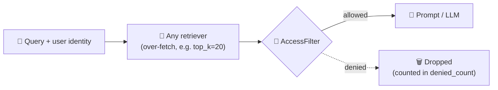

# 🔐 needtoknow-haystack

**Permission-aware retrieval for [Haystack](https://haystack.deepset.ai/).**
Your RAG pipeline should answer only from documents the user is allowed to see. `AccessFilter` makes sure it does.

[](https://github.com/Sanoer11/needtoknow-haystack/actions/workflows/ci.yml)
[](https://www.python.org/)
[](https://haystack.deepset.ai/)
[](LICENSE)

---

### 🚨 The problem

Most RAG apps search one shared index, and search ranks by **relevance**, not by **who is asking**.
Ask *"What are the salary bands?"* and the HR documents come back to anyone. Whatever the retriever returns lands in the LLM prompt, and from there in the answer.

### 📊 Measured, not assumed

| Pipeline | Results | Leaked | Leak rate | Queries with a leak |
|---|---:|---:|---:|---:|
| Retriever only | 250 | 145 | 🔴 **58.0%** | 50 / 50 |
| Retriever + `AccessFilter` | 240 | 0 | 🟢 **0.0%** | 0 / 50 |

<sub>From [`examples/leak_benchmark.py`](examples/leak_benchmark.py) on Haystack 3.4.1: 5 users × 10 probing queries over a synthetic company corpus (HR, finance, engineering, legal + public docs), BM25 top-5. A result counts as a leak when the user is not entitled to the document. Runs offline, no LLM or API key needed.</sub>

---

### ⚙️ How it works



Every document says who may read it in its metadata. `AccessFilter` keeps a document when **any** rule matches:

| Rule | Metadata (default key) | Example |
|---|---|---|
| 👤 The user is listed | `allowed_users` | `{"allowed_users": ["alice", "bob"]}` |
| 👥 One of the user's groups is listed | `allowed_groups` | `{"allowed_groups": ["hr"]}` |
| 🌍 The document is public *(opt-in via `public_field`)* | e.g. `public` | `{"public": True}` |

Values can be a list or a single string. Matching is exact and case-sensitive.

### 🛡️ Secure by default

- **Fail closed:** a document with no access metadata is **denied**, unless you set `allow_unlabeled=True`.
- **No anonymous filtering:** an empty `user_id` raises `ValueError` instead of silently returning nothing or everything.
- **Strict public flag:** only the exact value `True` makes a document public. `"yes"` does not.
- **Store-agnostic:** works after any Haystack retriever (in-memory, Qdrant, Elasticsearch, pgvector, and more).

---

### 📦 Installation

```bash
pip install git+https://github.com/Sanoer11/needtoknow-haystack.git
```

Works with Haystack 2.31+ and Haystack 3.x. CI tests every push on Python 3.10 and 3.13 against both.

### 🚀 Quickstart

```python
from haystack import Document, Pipeline
from haystack.components.retrievers.in_memory import InMemoryBM25Retriever
from haystack.document_stores.in_memory import InMemoryDocumentStore

from needtoknow_haystack import AccessFilter

store = InMemoryDocumentStore()
store.write_documents(
    [
        Document(content="Q3 salary bands for engineering", meta={"allowed_groups": ["hr"]}),
        Document(content="Engineering onboarding guide", meta={"allowed_groups": ["engineering"]}),
        Document(content="Company holiday calendar", meta={"public": True}),
        Document(content="Alice's performance review", meta={"allowed_users": ["alice"]}),
    ]
)

pipeline = Pipeline()
pipeline.add_component("retriever", InMemoryBM25Retriever(document_store=store, top_k=20))
pipeline.add_component("access_filter", AccessFilter(public_field="public", top_k=5))
pipeline.connect("retriever.documents", "access_filter.documents")

result = pipeline.run(
    {
        "retriever": {"query": "salary bands, onboarding guide, holiday calendar and performance review"},
        "access_filter": {"user_id": "bob", "groups": ["engineering"]},
    }
)

for doc in result["access_filter"]["documents"]:
    print(doc.content)
print("denied:", result["access_filter"]["denied_count"])
```

```
Engineering onboarding guide
Company holiday calendar
denied: 2
```

The retriever matched all four documents. Bob is in `engineering`, so he gets the onboarding guide and the public calendar. The HR salary sheet and Alice's review never reach the prompt.

---

### 🎛️ Parameters

| Parameter | Default | Description |
|---|---|---|
| `users_field` | `"allowed_users"` | Metadata key listing allowed user IDs |
| `groups_field` | `"allowed_groups"` | Metadata key listing allowed groups |
| `public_field` | `None` | Metadata key marking public documents (disabled when `None`) |
| `allow_unlabeled` | `False` | Whether documents without access metadata are readable by everyone |
| `top_k` | `None` | Maximum number of allowed documents to return |

`run(documents, user_id, groups=None)` returns:
- `documents`: allowed documents, in the retriever's order, trimmed to `top_k`
- `denied_count`: how many documents were removed

### 💡 Tips

**Over-fetch, then trim.** Filtering happens after retrieval. If the retriever returns 5 documents and 3 are restricted, the user gets 2. Ask the retriever for more candidates (`top_k=20`) and let `AccessFilter(top_k=5)` keep the best allowed ones. That is why the protected benchmark run returns 240 results instead of 250: for a few queries, fewer than 5 of the 20 candidates were allowed.

**Loading saved pipelines (Haystack 3).** Haystack 3 only deserializes components from allowlisted modules:

```python
Pipeline.loads(yaml_text, allowed_modules=["needtoknow_haystack"])
```

---

### ⚠️ Limitations

- **Your metadata is the source of truth.** The filter trusts `allowed_users` / `allowed_groups` written at indexing time. Sync them from your real permission system, and resolve `user_id` and `groups` from an authenticated session, never from the user's prompt.
- **Post-retrieval filtering.** Restricted documents are still searched, just never returned. For very large or highly restricted corpora, also use your document store's native filters to narrow the search.
- **Retrieval-level protection.** It stops restricted documents reaching the prompt. It does not stop an LLM from repeating what an allowed document says, or from inferring facts by combining allowed documents.

### 🗺️ Roadmap

- [ ] **Database-side filtering** for Qdrant and Elasticsearch, so restricted documents are never searched
- [ ] **OpenFGA integration**, so permissions come from a real authorization system instead of hand-written metadata
- [ ] **Real-data benchmark** on per-person mailboxes (Enron email dataset) instead of a synthetic corpus

---

### 🧪 Development

```bash
pip install -e ".[dev]"
pytest
ruff check . && ruff format --check .
mypy src
python examples/leak_benchmark.py
```

### 🧬 Background

This component comes from [**NeedToKnow**](https://github.com/Sanoer11/needtoknow), my permission-aware RAG system built with LangGraph and MCP servers. With 5 users × 10 adversarial probes (250 retrieved results), it measured a **43.2% leak rate without the permission lock and 0% with it**. `needtoknow-haystack` packages that idea as a reusable Haystack component.

---

### 👋 Author

**Sanoer Soni**: ECE (AI/ML) @ MIT-WPU, Pune. I build AI systems that run where it matters.

[](https://github.com/Sanoer11)
[](https://www.linkedin.com/in/sanoer/)
[](mailto:sanoersoni26@gmail.com)

Found a bug or have an idea? [Open an issue](https://github.com/Sanoer11/needtoknow-haystack/issues). ⭐ the repo if it helped.

### 📄 License

Apache-2.0
